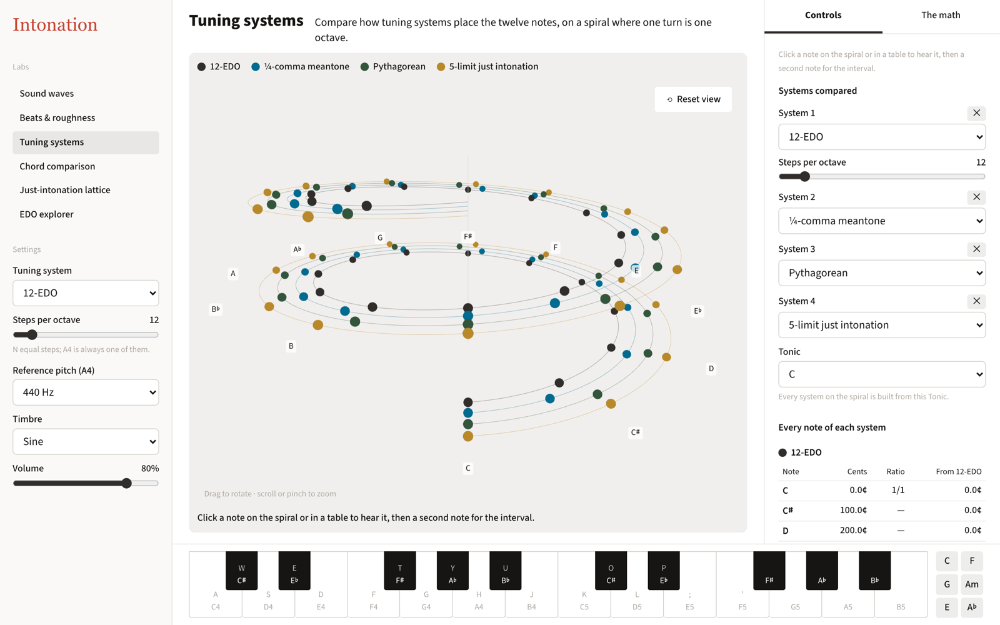
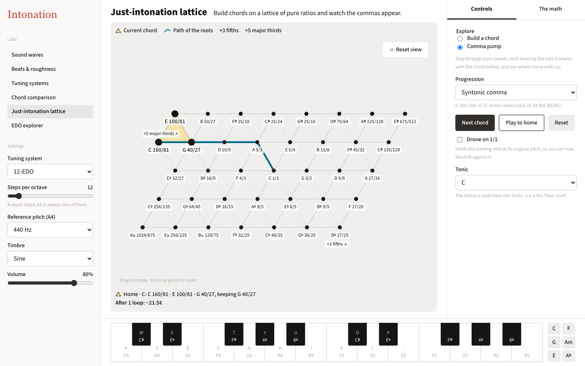
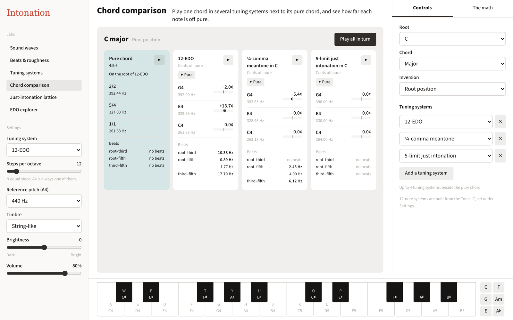
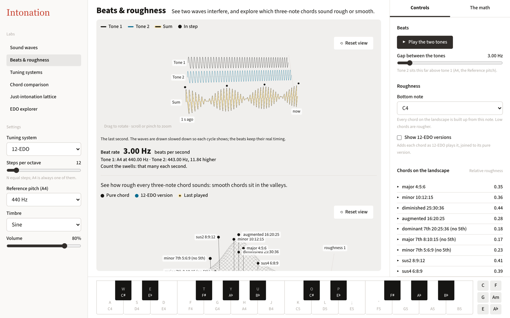

# Intonation

A website for exploring the math and acoustics of tuning, chords and sound waves. It is organised as six labs. Each lab has a visual in the center, its controls on the right, and a "The math" tab that shows the calculations behind what is on screen.



## Labs

| Lab | What it does |
| --- | --- |
| Sound waves | Build a timbre from its first 16 harmonics and see the waveform they add up to. |
| Beats & roughness | Shows two tones interfering and the beat rate between them, and a landscape of how rough each three-note chord is. |
| Tuning systems | Places the twelve notes of up to four tuning systems on a 3D spiral, one turn per octave, with a table of cents and ratios for each. |
| Chord comparison | Plays one chord in up to four tuning systems next to the pure chord, with each note's offset in cents and the beat rate between each pair of notes. |
| Just-intonation lattice | A lattice of pure ratios (×3 fifths, ×5 major thirds, optionally ×7) for building chords, plus comma pumps that step through a progression and measure the drift. |
| EDO explorer | For any N from 5 to 72, shows how close N-EDO gets to the pure intervals, and the error across every N. |

### Just-intonation lattice: comma pump

The syntonic comma pump (C–Am–Dm–G–C) after one loop. Each chord keeps the note it shares with the previous one, and the starting C comes back as 160/81, 21.5¢ flat.



### Chord comparison

A C major chord with the string-like timbre, compared in 12-EDO, ¼-comma meantone and 5-limit just intonation. The beat rates come from the harmonics of the chosen timbre.



### Beats & roughness

Two tones 3 Hz apart and their sum, above a 3D roughness landscape of three-note chords.



## Shared settings

The left rail holds settings that apply to every lab:

- **Tuning system**: 12-EDO, any N-EDO, Pythagorean, 5-limit just intonation, ¼-comma meantone, Werckmeister III, Vallotti or Kirnberger III, with a Tonic for the non-EDO systems.
- **Reference pitch**: the frequency of A4, 440 Hz by default.
- **Timbre**: sine, organ-like, string-like, brass-like or voice-like, or a custom timbre made in the Sound waves lab.
- **Volume**.

An on-screen keyboard at the bottom plays the current tuning system. On a desktop, the home row (A S D F …) plays the white keys from C4 and the row above plays the black keys.

All state is kept in the URL, so a setup can be shared as a link. There are no accounts and no server.

## Stack

TypeScript, React and Vite. The 3D scenes use three.js through react-three-fiber. Sound is generated with the Web Audio API directly, so frequencies are not rounded to a 12-note grid. See [docs/adr/0002-static-react-three-fiber-raw-web-audio.md](docs/adr/0002-static-react-three-fiber-raw-web-audio.md).

## Running locally

Requires Node.js 20.19+ or 22.12+.

```sh
npm install
npm run dev
```

| Command | Purpose |
| --- | --- |
| `npm run dev` | Start the Vite dev server |
| `npm run build` | Type-check and build to `dist/` |
| `npm run preview` | Serve the built site |
| `npm run typecheck` | Type-check only |
| `npm test` | Unit tests (Vitest) |
| `npm run test:smoke:install` | Install Chromium for the smoke tests (once) |
| `npm run test:smoke` | Browser smoke tests (Playwright) |

## Project docs

- [GLOSSARY.md](GLOSSARY.md): the terms the site and code use (tuning system, temperament, EDO, comma and so on).
- [docs/adr/](docs/adr/): architecture decisions.
- [design-system/README.md](design-system/README.md): design tokens, fonts and usage rules.
